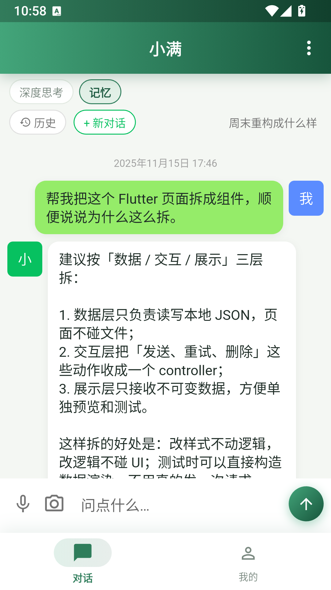
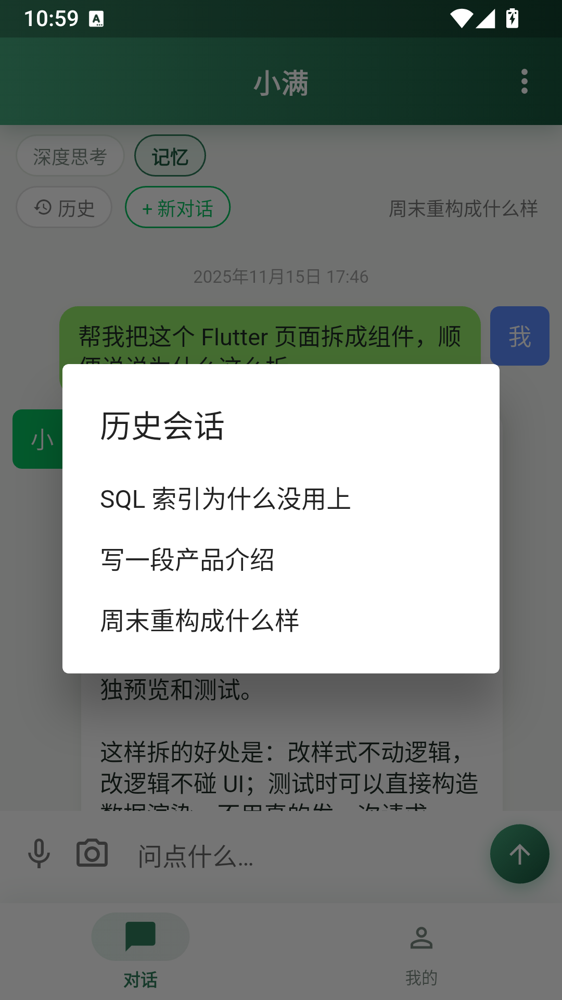
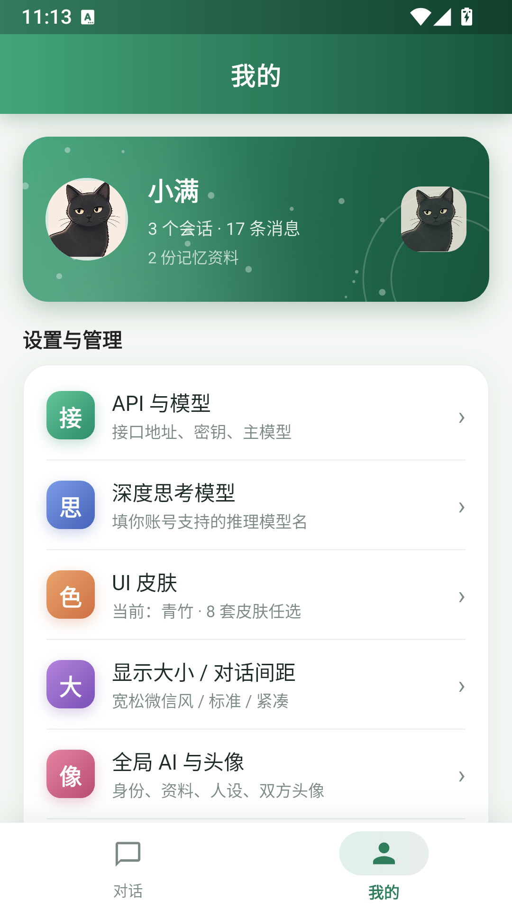
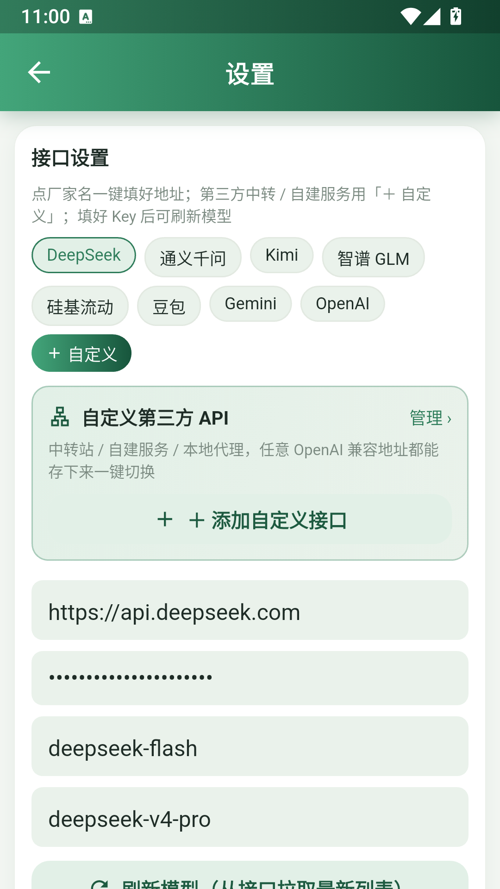
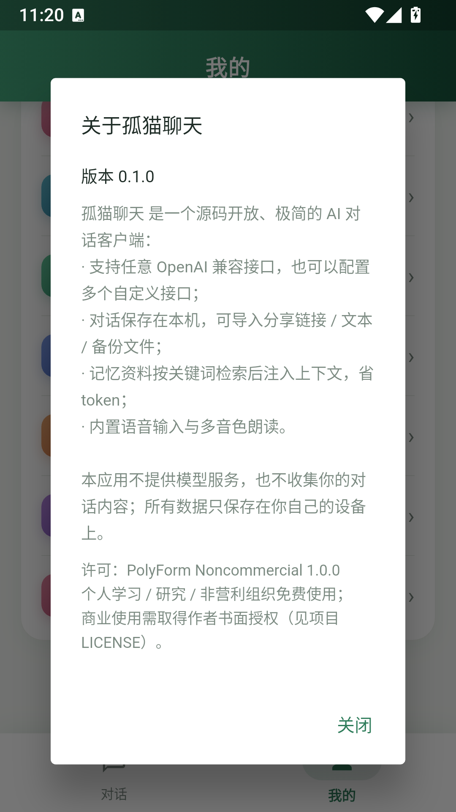
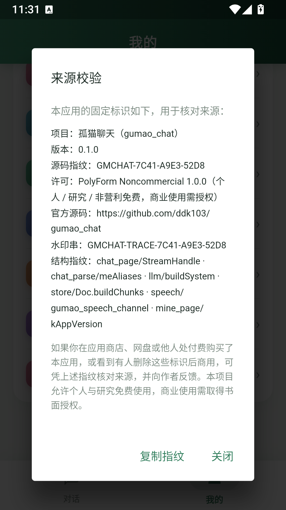
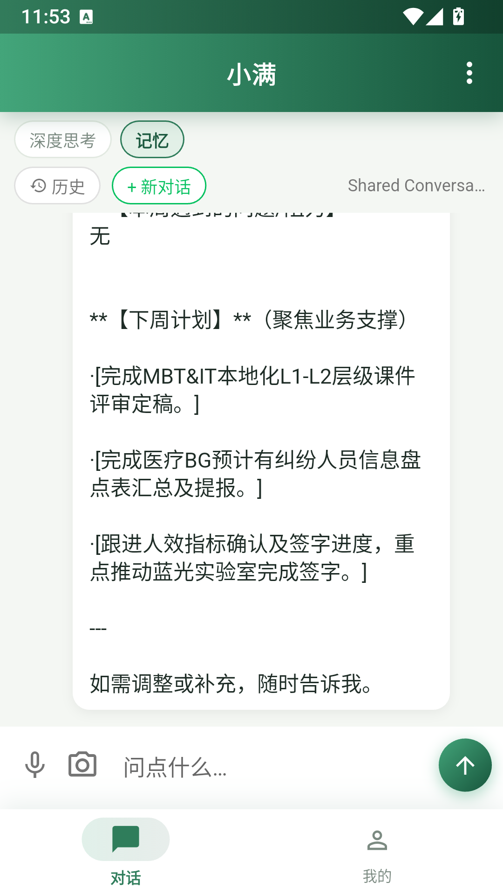
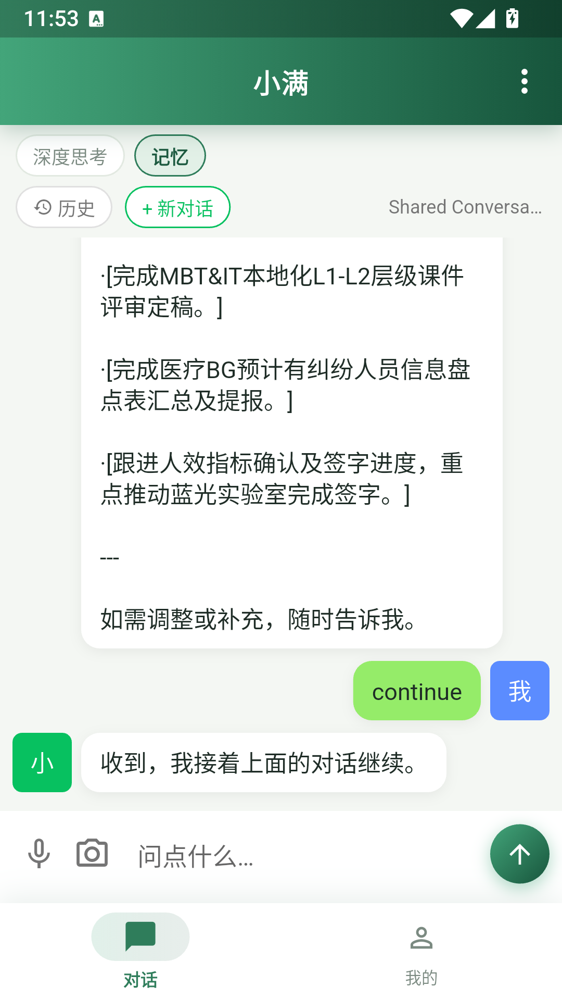

# 孤猫聊天

一个源码开放、极简的 AI 对话 Android 客户端：自带完整的聊天体验（流式回复、多会话、导入导出、长期记忆、语音输入与朗读），接口走任意 **OpenAI 兼容** 服务，**不绑定任何厂商**，也不收集你的数据。

项目地址：<https://github.com/ddk103/gumao_chat>

> 本应用**不提供模型服务**。你需要自备 API Key（DeepSeek / 通义千问 / Kimi / 智谱 / Gemini / OpenAI / 自建网关等均可）。

## 功能

- **任意 OpenAI 兼容接口**：内置常见厂商预设，一键填好地址与模型；支持添加多个「自定义第三方接口」（中转站 / 自建网关 / 本地 Ollama）。
- **流式对话**：SSE 逐字输出，可开启「深度思考」走推理模型；支持重新生成、复制、长按菜单。
- **多会话管理**：历史会话切换 / 删除，会话自动命名。
- **导入导出**：DeepSeek 分享链接导入、TXT / JSON / MD 文件导入、粘贴文本导入；支持导出 JSON 备份与 TXT。
- **长期记忆资料**：把文稿 / 聊天记录导入为资料，按关键词检索后注入上下文（有 token 预算，不整段灌）。
- **AI 身份设定**：名字、风格、资料、双方头像（内置 1:1 头像裁剪）。
- **语音**：系统语音输入（离线识别，失败可走在线转录），多角色音色朗读，可调语速 / 音调 / 角色差异；也支持 OpenAI 兼容的在线 TTS。
- **外观**：多套主题皮肤、三档显示密度、微信式气泡。
- **隐私合规**：首启隐私政策弹窗，不同意即退出；所有数据保存在本机。
- **零后端**：没有账号系统、没有统计 / 广告 / 推送 SDK。

## 截图

| 对话 | 历史会话 | 我的 |
|---|---|---|
|  |  |  |

| 接口设置 | 关于与许可 | 来源校验（隐藏入口） |
|---|---|---|
|  |  |  |

| DeepSeek 分享链接导入 | 导入后继续对话 |
|---|---|
|  |  |

## 构建

### 环境

- Flutter **3.27+**（开发与验证使用 3.44 / Dart 3.12）
- JDK 17
- Android SDK（compileSdk 由 Flutter 决定，当前为 36，minSdk 24）

### 命令

```bash
flutter pub get
flutter analyze          # 应输出 No issues found!
flutter build apk --release --target-platform android-arm64
```

产物：`build/app/outputs/flutter-apk/app-release.apk`。

> 仓库内 `android/app/build.gradle.kts` 默认使用 debug 签名（`signingConfigs.getByName("debug")`），方便直接安装自测。
> 若要上架或正式分发，请自行生成 keystore 并在 `android/app/build.gradle.kts` 中配置 release 签名。

## 使用

1. 安装 APK，首次启动同意隐私政策。
2. 打开「我的 → API 与模型」：
   - 点厂家名（如 DeepSeek）自动填好接口地址与模型名；
   - 填入你自己的 **API Key**，点「保存设置」；
   - 想用推理模型，把「深度思考模型」填上（例如 `deepseek-v4-pro`）。
3. 回到「对话」直接开聊。没填 Key 时会自动引导到设置页。

### 自定义接口

「我的 → API 与模型 → ＋ 自定义」可以保存任意 OpenAI 兼容服务：

- 接口地址填到 `/v1` 或完整 `/chat/completions` 都行；
- 普通模型 / 深度思考模型可留空，随后点「刷新模型」拉取实时列表。

## 数据与隐私

- 配置、会话、记忆资料都存放在应用私有目录（`cfg.json` / `chats.json` / `docs.json`），卸载即删除。
- 只有你发送消息时，文本才会通过 HTTPS 发往**你自己配置的**模型接口。
- 应用内「我的 → 备份数据」可导出全部数据；备份文件含 API Key，请妥善保管。
- 完整政策见 [`assets/privacy_policy.txt`](assets/privacy_policy.txt)。

## 项目结构

```
lib/
  main.dart           入口 + 底部两个 Tab（对话 / 我的）
  chat_page.dart      对话页：流式回复 / 重新生成 / 导入导出 / 分享链接
  chat_parse.dart     聊天记录解析（纯 Dart，可单独测试）
  chatlog.dart        导出与时间格式化
  share_import.dart   DeepSeek 分享链接导入
  llm.dart            OpenAI 兼容调用层、SSE、模型列表、记忆检索、system prompt
  store.dart          数据层：Cfg / Session / Msg / Doc 的 JSON 持久化
  memory_page.dart    记忆资料库
  settings_page.dart  接口、AI 设定、头像、主题
  voice_page.dart     音色、朗读参数、语音输入
  speech.dart         语音通道（调用原生 SpeechPlugin）
  mine_page.dart      我的
  privacy.dart        隐私政策同意
  ui.dart / decor.dart 主题与通用组件
android/              原生工程（含 Kotlin 语音插件 SpeechPlugin.kt）
tool/                 开发辅助脚本（聊天记录解析自测）
```

## 开发

```bash
dart run tool/parse_file.dart "C:\path\to\对话记录.txt"   # 验证本地聊天记录解析
dart run tool/check_share.dart https://chat.deepseek.com/share/xxxx   # 验证分享链接解析（真实接口）
dart run tool/share_to_chats.dart https://chat.deepseek.com/share/xxxx out.json  # 导出成 App 会话，便于复现
```

## 参与贡献

欢迎 Issue 与 PR，请先看 [CONTRIBUTING.md](CONTRIBUTING.md)。

## 许可证

本项目采用 **[PolyForm Noncommercial License 1.0.0](LICENSE)**（源码开放，非 OSI 开源）。

| 使用场景 | 是否需要授权 | 费用 |
|---|---|---|
| 个人学习 / 研究 / 实验 / 私人娱乐 | 不需要 | 免费 |
| 慈善组织、教育机构、公共研究机构、政府机构 | 不需要 | 免费 |
| 修改源码、免费分发（须附带许可与版权声明） | 不需要 | 免费 |
| **任何商业用途**（上架收费、内购、广告、商业产品集成、公司内部商业运营、收费定制交付等） | **需要书面授权** | 按需协商 |

> 商业授权通过在 [项目仓库](https://github.com/ddk103/gumao_chat/issues/new) 提 Issue 申请（标题注明「商业授权」）。
> 请在申请中说明：使用场景、用户规模、是否修改源码、是否需要去除品牌标识。

完整条款见 [LICENSE](LICENSE)（中英对照，英文原文具有法律效力）；商业授权说明见 [COMMERCIAL.md](COMMERCIAL.md)。

## 来源核验与隐藏功能

本项目是可追溯的：搬运源码、改个名字再发布，会留下可核对的证据（也能作为维权依据）。

- **源码层**：每个 `.dart` / `.kt` / `.xml` / `.kts` 文件头都有版权声明与文件级 Trace 编号。
- **APK 层**：AndroidManifest 的 `com.gumao.chat.trace`、`assets/trace.json`、隐私政策文本里都有项目指纹。
- **编译层**：`lib/trace.dart` 里的指纹常量与零宽隐形水印会编进 `libapp.so`，用 `strings` 也能搜到。
- **隐藏入口**：
  - 「我的」页连点身份卡片 **7 次**；
  - 或「我的 → 关于与许可」**长按版本号**；
  会打开「来源校验」页，显示指纹、许可范围，并支持一键复制。
- **核对工具**：

  ```bash
  python tool/verify_origin.py app-release.apk      # 核对 APK
  python tool/verify_origin.py ../suspect-source    # 核对源码目录
  ```

  命中任意一层即给出「同源证据」与具体文件位置。

> 说明：这不是 DRM，无法阻止彻底重写；但「拿走源码 / 反编译小改」很难同时抹掉
> 四层标识，删除标识本身也违反 [LICENSE](LICENSE) 的 Notices 条款。

## 免责声明

本项目仅提供客户端，不提供、不代理任何模型服务。使用第三方接口产生的内容与费用由服务商与你本人负责；
请遵守所在地区法律法规与各服务商的用户协议。
